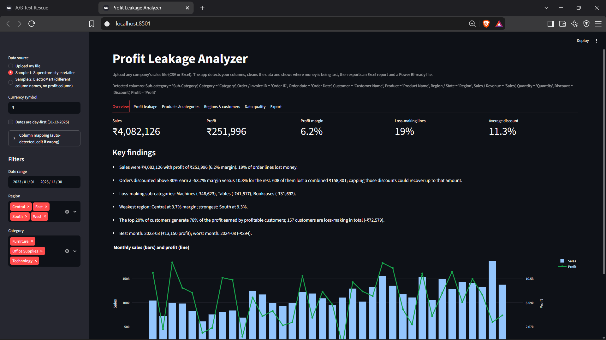
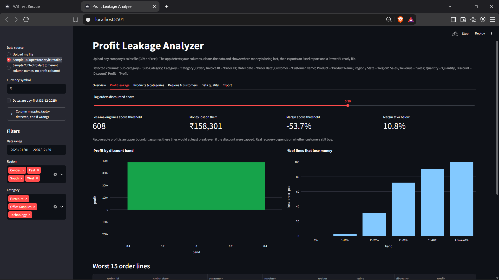
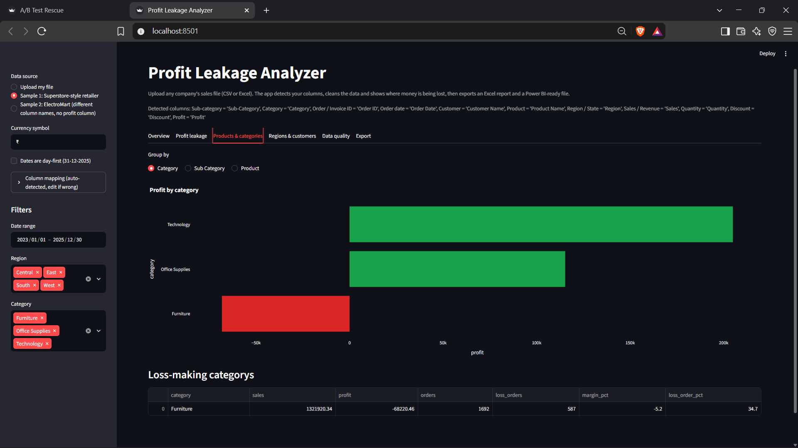

# Profit Leakage Analyzer (SQL + Excel + Power BI + Python)

**Business question:** *Where is a company losing money without noticing, and what should it change?*

Upload any company's sales file (CSV or Excel). The tool detects the columns, cleans the data, finds
where discounts, products, regions and customers leak profit, and exports an Excel report plus a
Power BI-ready file.

**Live demo:** _add your Streamlit link here_

## Key findings on the sample retailer (simulated data)
- Overall margin is only **6.2%**, and **19%** of order lines lose money.
- Orders discounted above 30% earn a **-53.7%** margin, versus **10.8%** for the rest.
- Capping those discounts could recover **up to ₹158K** (an upper bound, see assumptions).
- Machines, Tables and Bookcases are loss-making; the Central region has the weakest margin.

   ## Screenshots
   
   
   

## What is inside
| Skill | Where |
|---|---|
| **SQL** (CTEs, window functions, NTILE, RANK, LAG) | `sql/queries.sql`, run with `run_sql.py` |
| **Excel** (SUMIFS, COUNTIFS, IFERROR, editable threshold, charts) | `outputs/profit_leakage_report.xlsx`, built by `report_excel.py` |
| **Power BI** (Power Query, DAX, 3 pages) | `powerbi/BUILD_GUIDE.md`, `powerbi/DAX_measures.md` |
| **Data cleaning and documentation** | `analysis.py`, `docs/data_dictionary.md` |
| **Python web app with file upload** | `app.py` (Streamlit) |

## Run it
```
python -m venv venv
venv\Scripts\activate            (Windows)     source venv/bin/activate   (Mac/Linux)
pip install -r requirements.txt
python generate_sample_data.py
python run_pipeline.py           # cleans data, runs SQL, builds Excel report and memo
streamlit run app.py             # interactive app
```

## Analyse a different company's file
1. Run `streamlit run app.py` and choose **Upload my file** in the sidebar.
2. Upload a CSV or Excel file. **Required:** a Sales/Revenue column, plus a Profit column or a Cost column.
   Optional columns (date, customer, product, category, region, discount) unlock more analysis.
3. Check the **Column mapping** box in the sidebar; fix any wrong guess.
4. Or from the command line: `python run_pipeline.py path/to/file.xlsx`

Try **Sample 2 (ElectroMart)** in the app: it uses different column names (Revenue, State, Disc %) and no profit column.

## Assumptions and limitations
- Sample data is **simulated** with planted problems so the findings can be verified.
- Profit = Sales - Cost when a profit column is missing (cost treated as the line total).
- Recoverable profit is an **upper bound** and ignores lost volume if discounts are capped.
- The tool finds patterns; it does not prove cause. Test any pricing change before rolling it out.

## Resume bullet
> Built an end-to-end profit analysis tool (SQL, Excel, Power BI, Python) that cleans any sales file and
> finds discount-driven losses; on a 7K-order retail dataset it showed orders discounted above 30% lost
> ₹158K, and the tool generalises to new company files through automatic column detection.
